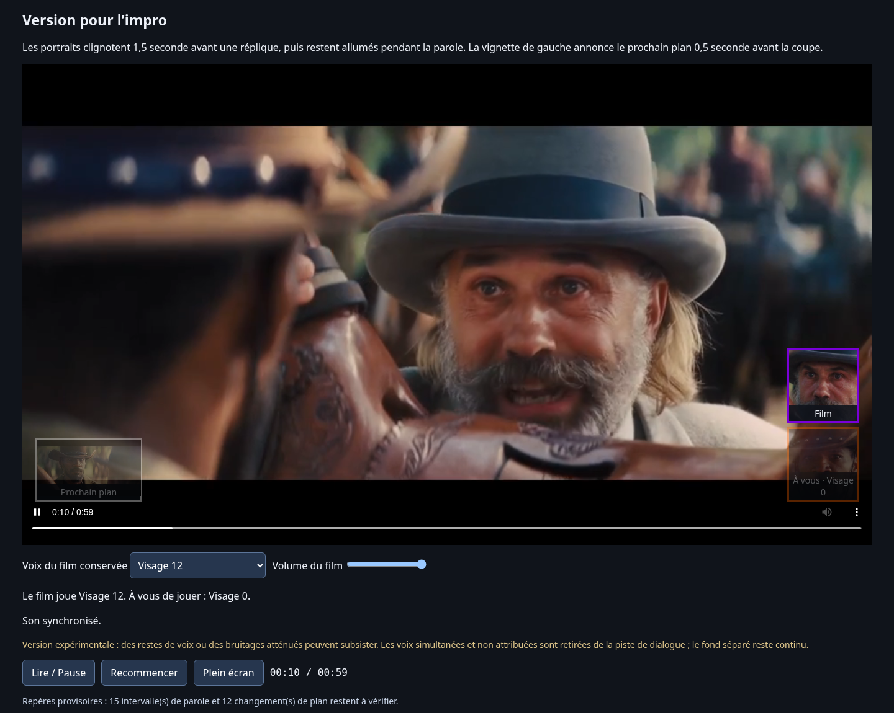

# Impro avec un personnage du film — V2 expérimentale

**[Télécharger le lecteur avec choix du personnage (ZIP)](impro-avec-personnage.zip?raw=1)**

1. Extraire le ZIP et ouvrir `impro-avec-personnage.html` dans Chrome, Edge ou Firefox.
2. Choisir **Voix du film conservée**, puis **Lire / Pause** et **Plein écran**.
3. Le lecteur précise **Le film joue… À vous de jouer…**, et les portraits portent **Film** et **À vous**.

- **Visage 12 conservé** : le film joue le personnage à la barbe grise (violet), vous jouez le visage 0 (orange).
- **Visage 0 conservé** : le film joue le visage 0, vous jouez le visage 12.
- **Ambiance seule** : toutes les voix sont à improviser, avec le fond séparé.
- **Aucune — vidéo muette** : silence complet.

Le rôle peut changer pendant la lecture. Le son suit la pause, les recherches et la vitesse. Les portraits clignotent 1,5 seconde avant la parole et restent éclairés pendant ; la vignette de gauche annonce le prochain plan 0,5 seconde avant la coupe. Le lecteur fonctionne hors connexion et n’enregistre pas le microphone.

## MP4 prêts à lire

| Vous jouez | Le film joue | Téléchargement |
| --- | --- | --- |
| Visage 0, orange | Visage 12, violet | [MP4 avec voix du visage 12](impro-avec-face-12.mp4?raw=1) |
| Visage 12, violet | Visage 0, orange | [MP4 avec voix du visage 0](impro-avec-face-0.mp4?raw=1) |

Les MP4 sont en pleine résolution et reprennent les portraits et le repère blanc de plan intégrés au rendu V1. Le lecteur HTML affiche une vignette du prochain plan.

## Qualité et corrections

Le dernier JSON utilisateur corrige le début : visage 0 de **1,85 à 3,43 s**, puis visage 12 de **3,50 à 5,33 s**. Le lecteur, l’éditeur et les deux MP4 reprennent cette correction, y compris les portraits intégrés.

Demucs 4.0.1, modèle officiel `htdemucs`, sépare les voix du mélange. Le fond `source − voix` reste continu ; seules les plages du dialogue choisi sont ouvertes avec des fondus de 10 ms. Les voix inconnues et les portions simultanées de personnages différents sont retirées de cette piste. Aucun découpage ne coupe le mélange original entier.

**La séparation reste expérimentale** : le modèle est entraîné sur la musique ; des restes de voix, une altération du timbre ou des bruitages atténués peuvent subsister. Les 28 intervalles fournis sont conservés, dont 15 restent à vérifier. Les 12 plans automatiques restent aussi à vérifier. Une attribution erronée peut donc conserver une mauvaise voix ; les paroles simultanées ne sont pas séparées entre locuteurs.

**[Télécharger l’éditeur duo (ZIP)](editeur-duo.zip?raw=1)** pour corriger paroles et plans. Le bouton **Télécharger la version impro** exporte les corrections courantes avec le choix du personnage conservé. La séparation audio est réutilisée. Télécharger et transmettre le JSON pour régénérer les MP4.

Vérifications : 38 tests Python ; test réel dans Chromium des deux rôles, du signal sonore, des pauses, du seeking, de la vitesse, des bornes modifiées, des chevauchements, du mode muet et du lecteur sans réseau. Une vérification des deux répliques de référence par transcription les retrouve dans le mix qui conserve leur personnage et ne les retrouve pas dans le mix opposé ; cela ne constitue pas une garantie d’absence de toute fuite vocale.

[Éditeur V1 des paroles et plans](editeur-paroles-plans.zip?raw=1) · [Premier MP4 entièrement muet](impro-corrigee.mp4?raw=1) · [Contrôle avec son original](controle-son-onde-audio.mp4?raw=1)
