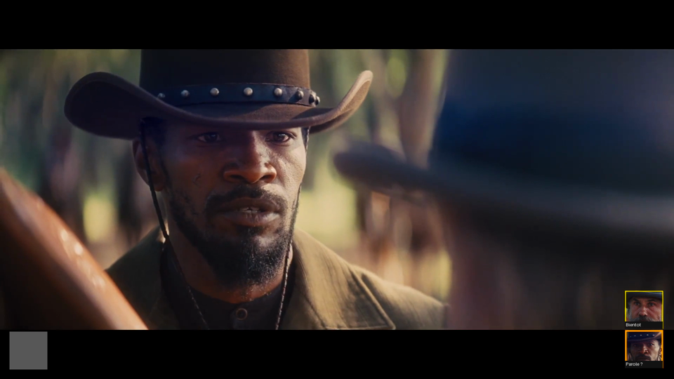

# Version corrigée de contrôle — DoublageBasic V1

[Télécharger la nouvelle vidéo](doublage-controle-corrige.mp4?raw=1)

L'ancienne vidéo `doublage-identifie.mp4` contient des attributions erronées et
n'est plus la version à contrôler.

Corrections :
- deux portraits fixes, sans doublons V0/V1 ; un seul ? temporaire pour les inconnus ;
- vérification acoustique passage par passage, sans propager une phrase connue à un groupe vocal entier ;
- « Bientot » distingue l'anticipation de 1,5 seconde de la parole en cours ;
- « Parole ? » et un cadre orange signalent une proposition à vérifier ;
- « Parole » correspond aux passages issus des références utilisateur ;
- aucune piste audio originale dans le rendu.

À 8 secondes, le visage 0 est proposé pour la parole en cours et le visage 12
est annoncé pour la réplique suivante : les deux indicateurs ont des rôles différents.

Cette version n'est pas une validation complète de l'identification des voix.
Les propositions acoustiques restent indicatives et les cas faibles sont laissés inconnus.
21 tests passent ; la lecture du rendu et les images de contrôle ont été vérifiées.
