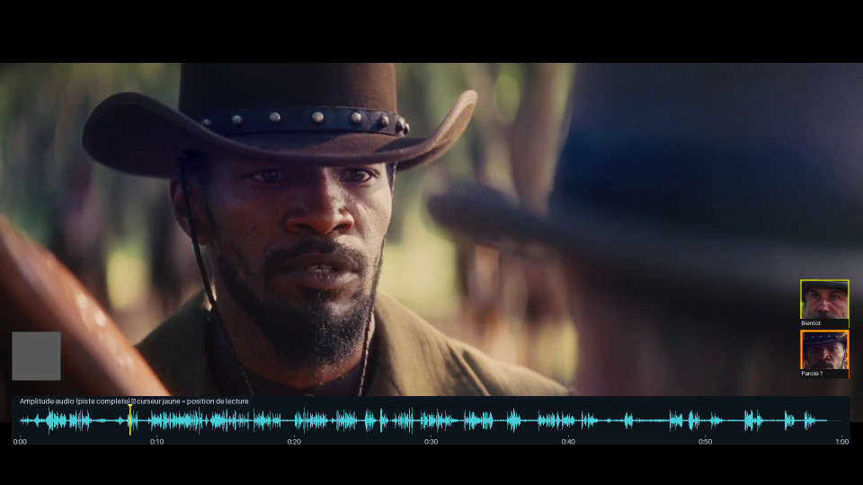

# Contrôle avec son, forme d’onde et curseur

[Télécharger la vidéo avec amplitude audio et curseur de lecture](controle-son-onde-audio.mp4?raw=1)

La bande cyan représente l’amplitude relative de la piste complète (voix,
musique et bruitages). Le curseur jaune suit la position de lecture, avec des
repères de temps. La bande est placée au-dessus de la zone des commandes du
lecteur pour rester visible en pause. Un déplacement dans la vidéo repositionne
également le curseur, intégré aux images du MP4.

Le son original normalisé, les deux portraits et le clignotement sont conservés :
- 1,5 seconde d’anticipation avec clignotement à 2 Hz ;
- éclairage constant pendant la parole ;
- deux locuteurs imposés d’après la confirmation utilisateur ;
- un petit badge d’incertitude, sans troisième portrait ;
- cadre orange / Parole ? pour les propositions acoustiques à vérifier.

## Limite de la détection des lèvres

Le programme détecte les visages et mesure les variations d’image autour de la
bouche. Ce n’est pas une reconnaissance fiable de lèvres en train de parler :
les mouvements de tête et l’éclairage peuvent aussi faire varier ce signal.
Sur cet extrait, aucune association automatique voix/lèvres n’a rempli les critères.
Les vignettes restent pilotées par les références acoustiques et les décisions
utilisateur. La forme d’onde ne prouve pas l’identité de celui qui parle.

Vérifications : 24 tests passés ; distinction entre silence et son, positions du
curseur vérifiées sur la vidéo finale à 8 et 30 secondes, pistes vidéo et audio
présentes. Le rendu V1 normal reste muet ; ce fichier est un contrôle avec son.
