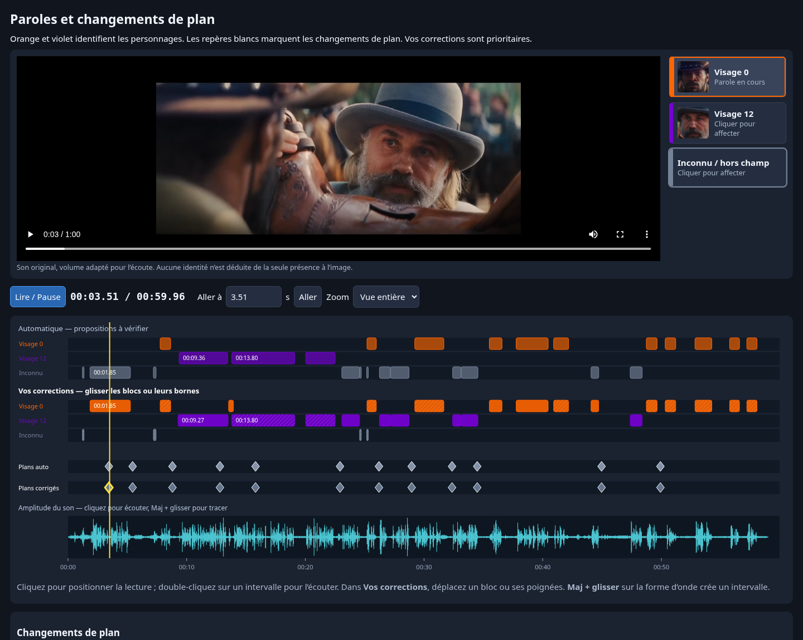

# Paroles, changements de plan et version pour l’impro

**[Télécharger le nouvel éditeur et le lecteur impro (ZIP)](editeur-paroles-plans.zip?raw=1)**

1. Extraire le ZIP et ouvrir `editeur-timeline.html` dans Chrome, Edge ou Firefox.
2. Corriger les losanges de la ligne **Plans corrigés** : déplacer, ajouter au curseur, supprimer, régler l’instant. Les boutons **Voir juste avant / juste après** aident à placer la coupe.
3. Cliquer **Télécharger la version impro** puis ouvrir le nouveau `version-impro.html` et utiliser **Plein écran**.
4. **Télécharger les corrections** sauvegarde ensemble les paroles et les plans. Transmettre le JSON pour régénérer un MP4.

Les **27 intervalles de parole du JSON fourni sont intégrés**, sans modification ni approbation supplémentaire. Douze changements de plan automatiques sont proposés. Quinze intervalles de parole et les douze coupes restent à vérifier. La détection d’origine est conservée sur les pistes automatiques. Les coupes sont des instants, indépendants des paroles ; elles peuvent se produire au milieu d’une réplique.

La vidéo de contrôle conserve le son original normalisé pour l’écoute. Le lecteur impro contient une **copie vidéo sans aucune piste audio**, et fonctionne hors connexion. Les portraits orange (visage 0) et violet (visage 12) clignotent 1,5 seconde avant la parole et restent allumés pendant. En bas à gauche, une vignette annonce le prochain plan 0,5 seconde avant la coupe. Les repères provisoires restent signalés. Le lecteur permet de jouer les voix en direct ; il n’enregistre pas le microphone.

Le ZIP contient aussi une première `version-impro.html` basée sur les corrections reçues et les plans automatiques encore à vérifier. Le bouton de l’éditeur permet d’en produire une nouvelle après chaque correction.

**[Télécharger le MP4 d’essai pour l’impro](impro-corrigee.mp4?raw=1)** : muet, pleine résolution, portraits et repère blanc de plan intégrés. Le lecteur HTML généré affiche une vignette du prochain plan ; le MP4 emploie le repère blanc du rendu V1. Ces exports restent provisoires pour les passages non validés.

Le JSON comprend un champ facultatif `cuts` (`id`, `time`, `reviewed`). Les anciens JSON de paroles restent compatibles et préservent les plans corrigés. Une liste vide retire tous les repères de plan. Import et export vérifient l’analyse et l’empreinte de la vidéo. Annuler / Rétablir, sauvegarde locale et zoom s’appliquent aux deux types de repères.

Vérifications : 32 tests Python ; essais réels dans Chromium des gestes d’édition des paroles et des plans, export/import, ancien format, refus des doublons et d’une autre source, restauration locale, génération du lecteur impro et synchronisation des annonces. Les médias exportés pour l’impro ont été contrôlés avec ffprobe : aucune piste audio. Les pages fonctionnent sans requête réseau.

[Ancien contrôle avec son et amplitude](controle-son-onde-audio.mp4?raw=1)
