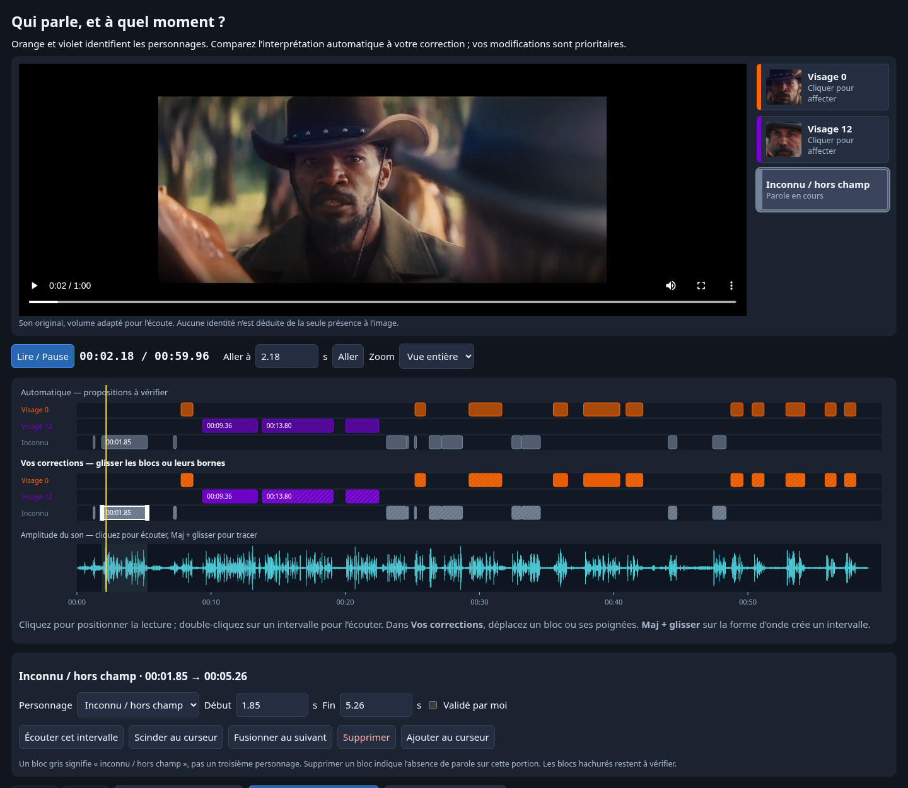

# Éditeur interactif des paroles

**[Télécharger l’éditeur autonome (ZIP, environ 3,7 Mo)](editeur-timeline.zip?raw=1)**

1. Télécharger et extraire le ZIP.
2. Ouvrir `editeur-timeline.html` dans Chrome, Firefox ou Edge. L’aperçu de code
   GitHub ne permet pas d’utiliser l’éditeur.
3. Modifier la piste **Vos corrections**, puis **Télécharger les corrections**.
4. Transmettre le fichier JSON dans le chat pour recalculer le rendu.

La vidéo, le son original normalisé, la forme d’onde et les portraits sont
intégrés au fichier HTML. L’éditeur fonctionne sans serveur et sans connexion
après téléchargement.

## Couleurs et édition

- Orange : visage 0. Violet : visage 12. Gris : inconnu / hors champ.
- La piste automatique reste intacte ; les corrections sont distinctes.
- Cliquer positionne la lecture ; double-cliquer écoute le passage.
- Déplacer un bloc ou ses poignées modifie les intervalles.
- Les champs Début / Fin permettent une saisie précise en secondes.
- Choisir un personnage réattribue le bloc sélectionné.
- Scinder au curseur sépare un bloc ; fusionner réunit deux blocs successifs du même personnage.
- Maj + glisser sur l’onde crée un intervalle ; Supprimer le retire.
- Annuler / Rétablir permettent de revenir sur les modifications.
- Les blocs hachurés restent à vérifier ; une correction de temps ne confirme pas implicitement le personnage.

Le bloc 1,85–5,26 s peut par exemple être scindé vers 3,3 s pour attribuer les
deux morceaux à des personnages différents. Cet exemple n’est pas appliqué à
votre place : la page démarre avec les propositions actuelles et les références
que vous avez déjà données.

## Sauvegarde et rendu

Le brouillon reste dans ce navigateur. Télécharger le JSON avant de changer de
machine ; ce JSON peut aussi être réimporté dans le même éditeur. Il contient les
intervalles et personnages, sans la vidéo. Il ne faut pas envoyer seulement une
capture d’écran pour appliquer des bornes précises.

Le code de rendu importe les corrections temporelles et leur donne priorité,
sans effacer les événements et scores bruts de diarisation. Un fichier d’une
autre vidéo/analyse est refusé. Les suppressions, ajouts et chevauchements sont
pris en charge. La V1 normale reste muette ; le son original sert au contrôle.

Vérifications : 29 tests Python ; gestes réellement testés dans Chromium :
scission à 3,3 s, couleurs, poignées, déplacement, création, fusion, suppression,
annulation, export/import, rejet d’une autre source, restauration et zoom.
Le ZIP a été extrait seul dans un autre dossier : vidéo et son lisibles, sans
requête réseau.

[Vidéo de contrôle avec son et onde, sans édition](controle-son-onde-audio.mp4?raw=1)
